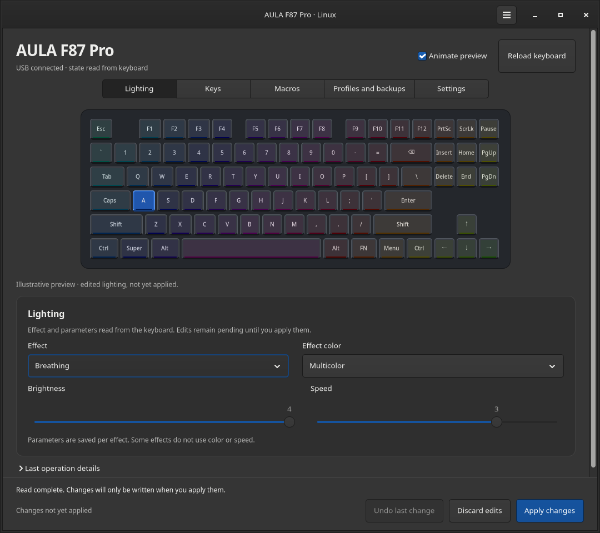
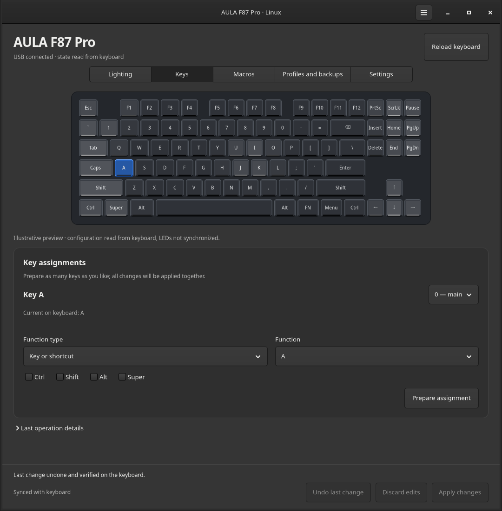
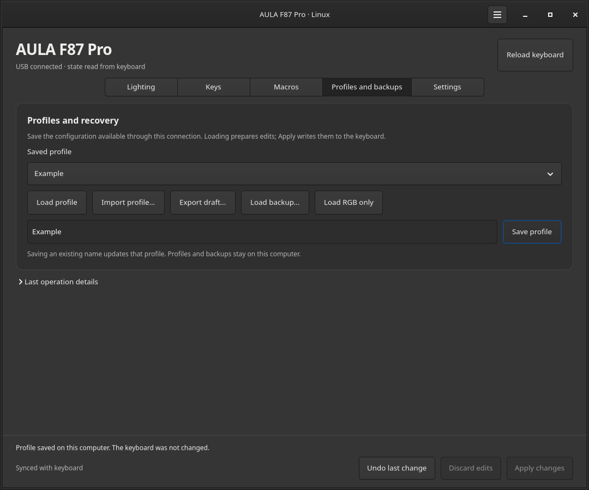
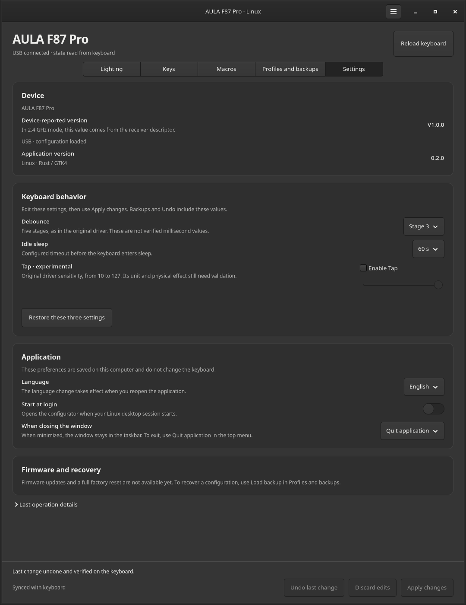
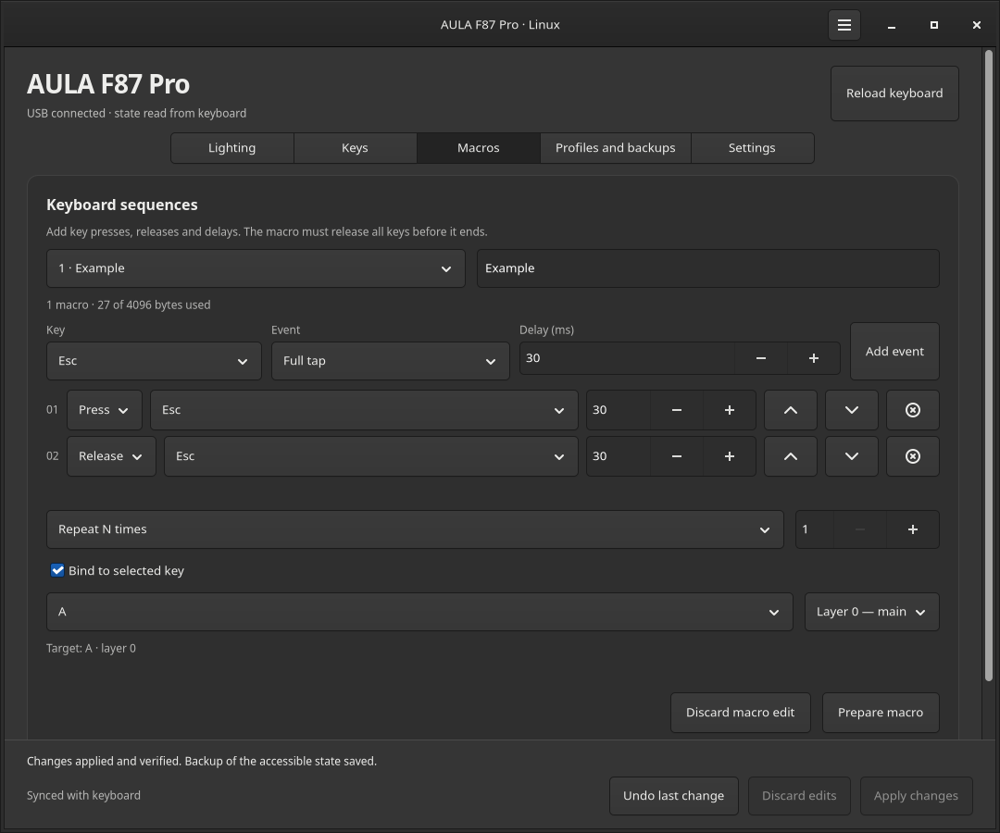

# AULA F87 Pro for Linux

English · [Português](README.pt.md)

A native Linux companion for the **AULA F87 Pro**. Set the lighting, remap keys,
prepare macros over USB, adjust keyboard behavior, and keep named profiles on
your computer. Built with
Rust and GTK4, using a protocol reconstructed from the original desktop driver.

[Download Linux preview](https://github.com/meursault03/aula-f87pro-linux/releases/tag/v0.3.0) ·
[Install](#install-on-linux) · [Settings](#settings) ·
[Connection support](#connection-support) ·
[Build from source](CONTRIBUTING.md)

*Native GTK interface with demonstration data. The animated RGB preview illustrates
the selected configuration; it does not stream the physical LEDs. The app supports
English and Portuguese, with screenshots matching the language of each README.*

## Install on Linux

**Version 0.3.0 is an experimental preview for Linux x86_64.**
Download a package from [Releases](https://github.com/meursault03/aula-f87pro-linux/releases/tag/v0.3.0):

| System | Download | Install |
| --- | --- | --- |
| Arch Linux | `aula-f87pro-0.3.0-1-x86_64.pkg.tar.zst` | `sudo pacman -U ./aula-f87pro-0.3.0-1-x86_64.pkg.tar.zst` |
| Ubuntu 24.04+ / Debian 13+ | `aula-f87pro_0.3.0_amd64.deb` | `sudo apt install ./aula-f87pro_0.3.0_amd64.deb` |
| Other compatible distributions | `aula-f87pro-0.3.0-linux-x86_64.tar.gz` | Extract and run `python3 install.py --udev` inside its folder. |

The archive needs GTK4 ≥ 4.10, glibc ≥ 2.39 and Python 3 for installation; it is
not a self-contained AppImage. Its installer writes to `~/.local/bin` and
`~/.local/share`. `--udev` uses the system's graphical authentication dialog to
install device-access rules. Omit that option if the rules are already installed.

The Arch and Debian packages include the desktop launcher, icon and udev rules.
Reconnect the keyboard or receiver after installation, then open **AULA F87 Pro**
from your application menu. Run the app as your regular desktop user.
Checksums are in `SHA256SUMS` beside the downloads.

## Configure your keyboard

1. Connect by USB, or select **2.4G** on the keyboard with its receiver inserted.
   Press a key if the keyboard is asleep and wait for the state to load.
2. Choose an effect, brightness, speed and palette in **Lighting**. The preview
   updates immediately; the hardware changes only after **Apply changes**.
3. In **Keys**, select a key and prepare a key, shortcut, media action or
   disabled assignment. You can prepare several edits before applying them.
4. **Undo last change** restores the last confirmed configuration.
5. Save named profiles in **Profiles and backups**. Loading a profile stages edits.
   **Load RGB only** transfers lighting between USB and receiver profiles
   while preserving keys, macros and connection-specific fields.

The app saves a backup before writing, checks the device again before applying,
and verifies the result by reading it back. A failed operation attempts to
restore the original accessible state. Drafts stay local until you apply them.

| Key assignments | Profiles and recovery |
| --- | --- |
|  |  |

## Settings

Use **Settings** for device information, keyboard behavior and app preferences.
Device changes are staged in the same draft as lighting and key assignments:
use **Apply changes** to write them, or **Undo last change** to restore the
previous confirmed configuration.

| Keyboard control | Available values |
| --- | --- |
| Debounce | Five stages, as in the original driver; these are not verified millisecond values. |
| Idle sleep | Disabled, or 30, 60, 90, 120, 180, 240, 300, 600, 900 or 1200 seconds. |
| Tap · experimental | Disabled, or sensitivity 10–127. The unit and physical effect still need validation. |

Debounce and idle-sleep values were written, read back and restored over USB.
Radio remains experimental; Tap behavior and actual sleep timing still need
physical validation.

**Restore these three settings** prepares debounce at stage 2, Tap disabled and
idle sleep at 300 seconds. It preserves lighting, key assignments and macros;
it is not a full factory reset. You still need to apply the draft.

The **Device-reported version** comes from the device descriptor. In 2.4 GHz
mode, it is the receiver's descriptor version, not an independently verified
keyboard firmware version. Firmware flashing is not available.

App preferences stay on your computer and take effect without writing to the
keyboard. Choose English or Portuguese in **Language**, then close and reopen
the app. **Start at login** opens it with your Linux desktop session.
**When closing the window** can quit the app or minimize it to the taskbar;
use **Quit application** in the top menu to exit while that preference is set
to minimize.

## Connection support

**AULA F87 Pro**

| Feature | USB cable | 2.4 GHz receiver |
| --- | --- | --- |
| 14 lighting effects, brightness, speed and color | Available | Experimental |
| Key assignments and shortcuts | Layers 0–3 | Layers 0–1 |
| Macro editing | Available | Requires USB |
| Profiles, RGB preview and undo | Available | Available |

**Standard AULA F87:** experimental USB support, pending hardware validation.
2.4 GHz configuration is not supported for this model.

Bluetooth, firmware updates and per-key RGB customization are not available.

## Macros over USB

Build a sequence of key presses, releases and delays, select its target key,
and use **Prepare macro** before applying. Every pressed key must be released.
Existing unsupported event types are kept intact rather than rewritten.

*Demonstration macro, captured with an isolated simulated backend. Screenshots do
not represent a hardware test or a global key recorder.*

## Local data and troubleshooting

Profiles, backups and undo data live in `$XDG_DATA_HOME/aula-f87pro`
(default `~/.local/share/aula-f87pro`). App preferences live in
`$XDG_CONFIG_HOME/aula-f87pro/settings.json` (default
`~/.config/aula-f87pro/settings.json`); start-at-login uses a desktop entry in
`$XDG_CONFIG_HOME/autostart`. Nothing is uploaded. Profiles can contain
personal macro sequences: inspect them before sharing them in an issue.

| Problem | What to check |
| --- | --- |
| Receiver detected, keyboard unavailable | Check the 2.4G switch, press a key, and retry **Reload keyboard**. |
| Permission error | Install the included udev rules and reconnect the device. Use a local desktop session. |
| Profile cannot be applied on this connection | Use **Load RGB only**, or connect using the mode where the full profile was saved. |
| Hardware changed outside the app | Save the draft as a profile, then reload or discard it before applying. |
| Old window after an update | Close the previous instance, then open the updated app. |

For a bug report, include the app version, distribution, desktop, connection mode,
and the text in **Last operation details**. Do not attach personal profiles
or the proprietary Windows installer.

## Development and license

See [CONTRIBUTING.md](CONTRIBUTING.md) for builds, tests and Linux packaging.
No proprietary executable or firmware is distributed.

MIT. Independent community software, not affiliated with AULA.
