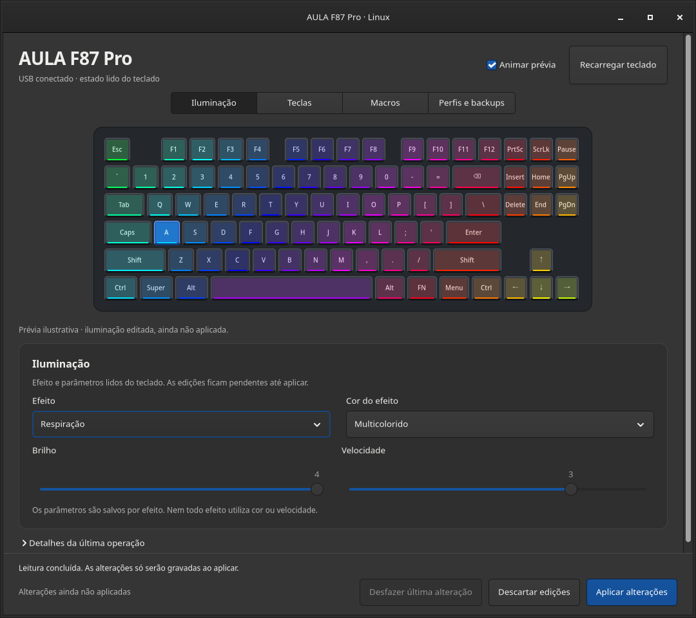
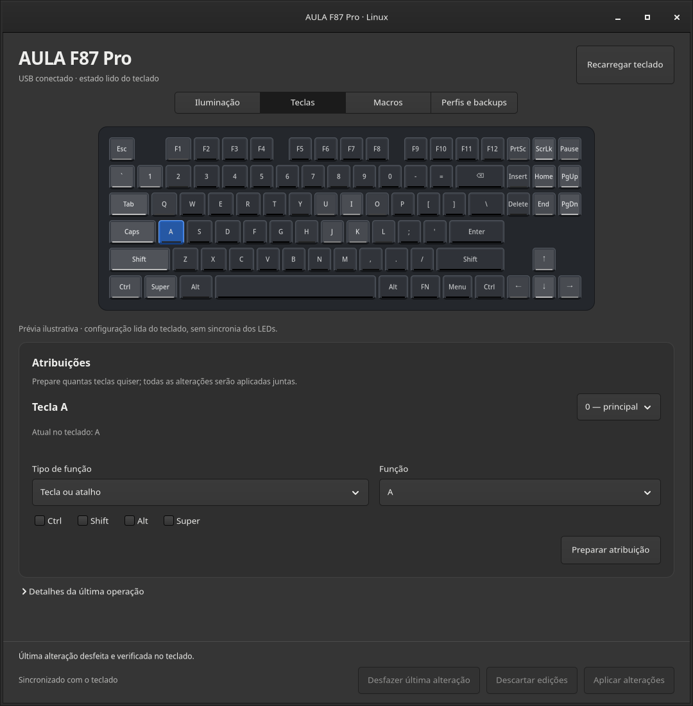
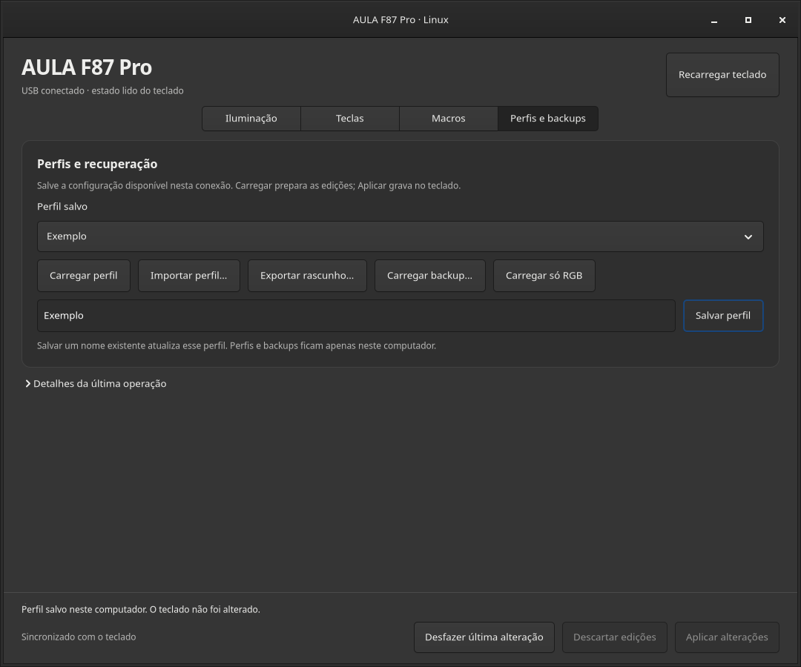
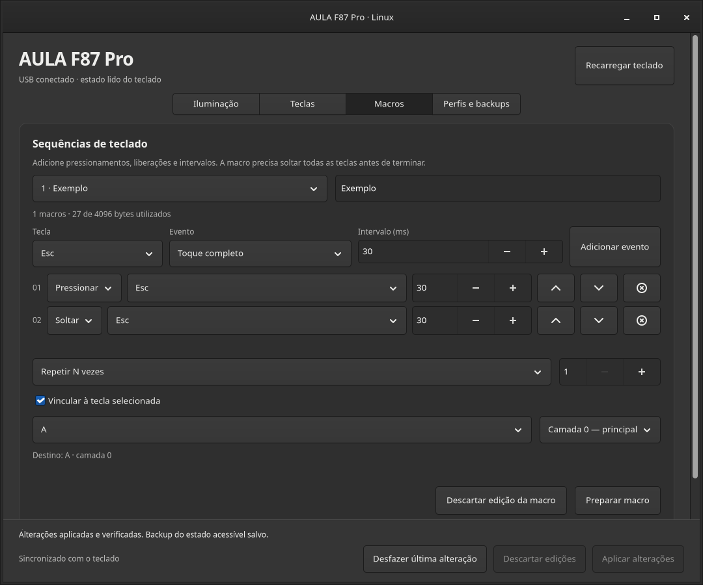

# AULA F87 Pro para Linux

[English](README.md) · Português

Um aplicativo nativo para configurar o **AULA F87 Pro no Linux**. Ajuste a
iluminação, remapeie teclas, prepare macros por USB e mantenha perfis nomeados
no seu computador. Feito em Rust e GTK4, com um protocolo reconstruído a partir
do programa original.

[Baixar para Linux](https://github.com/meursault03/aula-f87pro-linux/releases/tag/v0.1.0) ·
[Instalação](#instalar-no-linux) · [Conexões](#suporte-por-conexão) ·
[Compilar](CONTRIBUTING.md)

*Interface GTK real com dados de demonstração. A prévia ilustra a configuração
selecionada; não transmite as cores atuais dos LEDs físicos.*

## Instalar no Linux

**A versão 0.1.0 é uma prévia experimental para Linux x86_64.**
Baixe o pacote em [Releases](https://github.com/meursault03/aula-f87pro-linux/releases/tag/v0.1.0):

| Sistema | Arquivo | Instalação |
| --- | --- | --- |
| Arch Linux | `aula-f87pro-0.1.0-1-x86_64.pkg.tar.zst` | `sudo pacman -U ./aula-f87pro-0.1.0-1-x86_64.pkg.tar.zst` |
| Ubuntu 24.04+ / Debian 13+ | `aula-f87pro_0.1.0_amd64.deb` | `sudo apt install ./aula-f87pro_0.1.0_amd64.deb` |
| Outras distribuições compatíveis | `aula-f87pro-0.1.0-linux-x86_64.tar.gz` | Extraia e execute `python3 install.py --udev` dentro da pasta. |

O arquivo `.tar.gz` precisa de GTK4 ≥ 4.10, glibc ≥ 2.39 e Python 3 para instalar;
não é um AppImage com todas as bibliotecas incluídas. O instalador usa
`~/.local/bin` e `~/.local/share`. A opção `--udev` abre a autenticação gráfica
do sistema para instalar as regras de acesso ao teclado. Omita essa opção se
as regras já estiverem instaladas.

Os pacotes Arch e Debian incluem atalho, ícone e regras udev. Reconecte o teclado
ou receptor após instalar e abra **AULA F87 Pro** pelo menu. Execute o aplicativo
com seu usuário normal da sessão gráfica. Os downloads incluem `SHA256SUMS`.

## Configurar o teclado

1. Conecte por USB ou coloque a chave do teclado em **2.4G** com o receptor
   conectado. Se estiver dormindo, pressione uma tecla e aguarde a leitura.
2. Em **Iluminação**, escolha efeito, brilho, velocidade e paleta. A prévia muda
   imediatamente; o teclado só muda ao clicar em **Aplicar alterações**.
3. Em **Teclas**, selecione uma tecla e prepare sua função, atalho, ação de mídia
   ou desativação. É possível preparar várias alterações antes de aplicar.
4. **Desfazer última alteração** recupera a configuração confirmada anterior.
5. Em **Perfis e backups**, salve e carregue configurações. **Carregar só RGB**
   transfere a iluminação de um perfil de cabo ou receptor, preservando as
   teclas, macros e os campos específicos da conexão atual.

O programa salva um backup antes de escrever, confere se o teclado mudou desde
a leitura e verifica o resultado por releitura. Em caso de falha, tenta recuperar
o estado acessível original. As edições ficam locais até serem aplicadas.

| Atribuições de teclas | Perfis e recuperação |
| --- | --- |
|  |  |

## Suporte por conexão

| Recurso | Cabo USB | Receptor 2,4 GHz |
| --- | --- | --- |
| 18 efeitos, brilho, velocidade e paleta | Disponível | Disponível, experimental |
| Teclas e atalhos | Camadas 0–3 | Camadas 0–1 |
| Edição e novos vínculos de macros | Disponível | Macros preservadas; edição exige cabo |
| Perfis, prévia RGB e desfazer | Disponível | Disponível para o estado acessível |

Interfaces admitidas: USB `258a:010c`, receptor `3554:fa09` e identificação do
teclado `03 00 00 00 01 0b`. Quando as duas conexões estão presentes, o programa
prefere o cabo. Detectar o receptor não confirma que o teclado esteja acordado.

A leitura pelo rádio pode ser intermitente. O programa repete consultas para
recuperar fragmentos e exige duas leituras completas iguais antes de aceitar
um bloco. Estado incompleto não permite gravação. O backup do rádio contém as
duas camadas expostas e somente o trecho de macros efetivamente lido; camadas
e bancos não lidos nunca são gravados. Perfis completos usam o formato da conexão
em que foram salvos.

**Bluetooth, atualização de firmware e RGB arbitrário por tecla ainda não estão
implementados.** A temporização e todos os modos de reprodução de macros ainda
precisam de validação física.

## Macros por USB

Monte uma sequência de pressionar, soltar e intervalos, escolha a tecla de destino
e use **Preparar macro** antes de aplicar. Toda tecla pressionada precisa ser
liberada. Eventos existentes ainda não editáveis são preservados.

*Macro de exemplo capturada com backend simulado e isolado. Os prints não são
um teste físico do teclado nem uma captura global de digitação.*

## Dados locais e problemas comuns

Perfis, backups e desfazer ficam em `$XDG_DATA_HOME/aula-f87pro`
(normalmente `~/.local/share/aula-f87pro`). Nada é enviado para servidores.
Perfis podem conter sequências pessoais; confira o conteúdo antes de compartilhá-los.

| Problema | O que conferir |
| --- | --- |
| Receptor detectado, teclado indisponível | Chave em 2.4G, pressione uma tecla e tente **Recarregar teclado**. |
| Falta de permissão | Instale as regras udev incluídas e reconecte o dispositivo. Use uma sessão gráfica local. |
| Perfil incompatível com a conexão | Use **Carregar só RGB** ou conecte no modo em que o perfil completo foi salvo. |
| Configuração alterada fora do programa | Salve o rascunho como perfil e recarregue ou descarte antes de aplicar. |
| Janela antiga após atualizar | Feche a instância anterior e abra a versão atualizada. |

Ao abrir uma issue, informe versão, distribuição, ambiente gráfico, conexão e
o texto em **Detalhes da última operação**. Não envie perfis pessoais nem o
instalador proprietário do Windows.

## Desenvolvimento e licença

[CONTRIBUTING.md](CONTRIBUTING.md) explica compilação, testes e empacotamento.
Não são distribuídos executáveis proprietários, firmware ou notas privadas de investigação.

MIT. Projeto comunitário independente, sem vínculo com a AULA.
